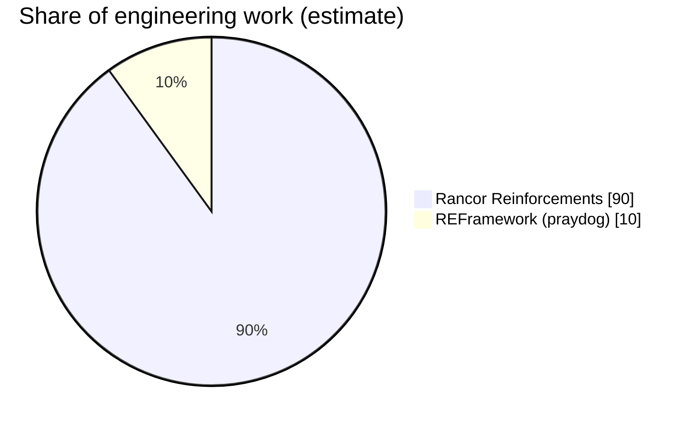

# Rancor Reinforcements

New bosses for the Rancor vortex fights of **Dragon's Dogma 2** (PC, Steam). A REFramework Lua script.

> Works only in the game's own Rancor events (regular, Virulent and Devouring). Story and quest fights, Satanica's event and the bosses' own lairs are never touched.

Download the ready-to-use build from [Nexus Mods](https://www.nexusmods.com/dragonsdogma2/mods/1817). This repository is the source code.

## Features

- While a Rancor wave is being set up, the big enemies the game is about to spawn are swapped for reinforcement bosses. The Rancor spawns them itself, so they count toward clearing the wave and work on every wave layout. Each swapped spawn record is restored right after it is used.
- **Wave pool** (one weighted pick per big-enemy slot; 2 reinforcements per regular Rancor, 3 per Virulent or Devouring one): Griffin (Norgan), Medusa with her pillar, Gagana, Nasty Dragon, Brine Minotaur, Brine Ogre, Brine Golem (regular Rancors only), Brine Cyclops. A Brine Skeleton Lord or Brine Lich replaces the game's own Skeleton Lord or Norgan Lich half the time.
- **Finales** (the ice dragon's slot): a regular Rancor rolls the Brine Drake, the Brine Dullahan or the ice dragon; a Virulent Rancor rolls the Evil Eye, the Brine Drake, the Brine Sphinx or the Vermund Purgener. The Devouring Rancor's dragon-carcass or Death finale can become the Sacred Arbor Purgener.
- Every reinforcement gets Rancor-appropriate HP and damage (Lesser Demon scaling, a boss's own stats, or a copy of the Thimble's learned stats), with a slider for each in the REFramework menu.
- Bosses that cannot normally fight outside their lair are made to: Medusa gets a virtual lair and a climbable pillar, the Evil Eye its summons, ground tentacles and arena teleports, the Brine Sphinx her warps spread over the arena.
- Nothing is spawned from nothing. Every monster comes through the Rancor's own spawn system, which is what keeps the game stable.

### How the swaps work

The Rancor event asks the game's `GenerateManager` for each wave enemy. The script hooks that request, and for a big-enemy slot decides, from the per-Rancor quota and the weights in the settings, whether the slot keeps its enemy or becomes a reinforcement. If so it changes the `CharacterID` on the request record and lets the game continue; after the enemy exists, the record is put back. Reinforcements are then tracked for the fight: HP and damage are applied once they exist, and boss-specific fixes run while they live.

### How the bosses are made to work

- **Medusa** (`ch255000`) only fights near her lair's hidden waypoint network. For a Rancor Medusa the script answers her waypoint searches with spots inside the arena, spawns a climbable pillar for her coil attack, grounds her and keeps her in combat. Her lair Medusa is untouched.
- **Evil Eye** (`ch270000`) spawns its minions, ground tentacles and detached-tentacle copies through its own spawn requests, which the Rancor area drops because they carry the wrong request type. The script retypes them so the Rancor creates them, keeps their prefabs loaded, places them on the ground around the player, and while the Eye lives turns every small Rancor enemy into one of its eyeballs. Its teleports are redirected onto the arena, and its summons die with it.
- **Brine Sphinx** (`ch253001_50`) has a warp table pointing at her own sanctuary thousands of metres away. Her out-of-fight warps are cancelled, her remaining warps land on spots around the arena, and her opening and gaze-dodge warps are off.
- **Golem, Purgeners** have their HP spread over their weak points so the boss bar and the medallion / weak-point mechanics still work at the higher HP.

## Installation

Requirement: [REFramework](https://github.com/praydog/REFramework) for Dragon's Dogma 2.

Copy the `reframework` folder from the release archive into the game folder (the one with `DD2.exe`), so that you have `reframework\autorun\RancorReinforcements.lua`. In game, press Insert for the REFramework menu, then `Script Generated UI > Rancor Reinforcements`. Settings are saved to `reframework\data\RancorReinforcements.json`.

## Building

There is nothing to compile. The release file is the source file with one line changed:

```
python3 tools/harness/make_release.py src/RancorReinforcements.lua RancorReinforcements.lua
```

`K.RELEASE = false` becomes `K.RELEASE = true`, which turns off every research hook, log file and developer menu. The dev build (`src/`) writes logs and research dumps to `reframework\data\` and exposes a test API (`RR_DEV`) for queuing a boss, forcing a finale or taking over the next spawn.

### Offline checks

`tools/harness` runs the script outside the game against a mock of the REFramework API (`mock_reframework.lua`):

```
pip install lupa
tools/harness/check.sh src/RancorReinforcements.lua
```

It loads the dev and release builds under several saved configs, draws the menu with every button pressed, calls every hook with empty arguments, runs a static check for undeclared globals, and simulates 600 Rancor fights to report what each big-enemy slot became and that every spawn record was restored.

## Source layout

| File | Purpose |
|---|---|
| `src/RancorReinforcements.lua` | The whole mod: the reinforcement table, spawn-record swapping, per-boss fixes, scaling, the menu and the dev tools |
| `tools/harness/mock_reframework.lua` | Stand-in for the REFramework Lua API, enough to load and exercise the script |
| `tools/harness/run_harness.py`, `runner.lua` | Loads the script in the mock, runs frames, hooks and the UI, reports Lua errors |
| `tools/harness/run_sim.py`, `sim_rancor.lua` | Simulated Rancor fights through the real swap code |
| `tools/harness/lua_globals.py` | Static check for globals read before they are declared |
| `tools/harness/make_release.py` | Makes the release copy |
| `dist/` | The release archive uploaded to Nexus Mods |

## Third-party code and credits

| Project | How it is used | Licence |
|---|---|---|
| [REFramework](https://github.com/praydog/REFramework) by praydog | The Lua runtime the script runs in: function hooking, access to the game's managed objects, the ImGui menu. Required, not included. | MIT |
| Capcom's Dragon's Dogma 2 | Every boss, animation and AI table is the game's own. The script only changes which enemy a Rancor spawns and answers the lair-bound AIs' searches. | - |

## Contributions

How much of Rancor Reinforcements is original work, and how much comes from what it builds on. The pie chart is an **estimate** of engineering work by area, not a measurement. The [line counts](#lines-of-code) further down are measured.



### How the estimate was made

The mod was split into five areas, each weighted by how much of the work it represents. Each area was then divided between this project and REFramework, whose hooking and object access every area depends on.

| Area | Weight | REFramework | Rancor Reinforcements |
|---|---|---|---|
| Spawn research and integration: how the Rancor requests its waves, the spawn record format, swapping and restoring records, per-Rancor quotas, the finale rolls | 25% | 3% | 22% |
| Making lair-bound bosses fight: Medusa's virtual lair and pillar, the Evil Eye's summons, tentacles and teleports, the Sphinx's warps, each one's AI tables read from the game | 35% | 3% | 32% |
| Stats: Lesser Demon scaling, learned Thimble stats, weak-point HP splits, damage multipliers | 10% | 1% | 9% |
| Menu and settings | 10% | 3% | 7% |
| Test tooling: the offline harness and Rancor simulator, the dev API, the in-game research dumps | 20% | 0% | 20% |
| **Total** | **100%** | **10%** | **90%** |

### Each project

**Rancor Reinforcements (about 90%)**
- The spawn research: which `GenerateManager` calls a Rancor wave goes through, what is in a spawn record, how group records copy their parent, why the Rancor area drops a boss's own requests (request type), and how to swap a record without breaking the wave count.
- The per-boss work, read out of each monster's think tables and controllers in the running game: Medusa's waypoint controller and beam targeting, the Evil Eye's parts-warp and warp-point controllers, the Sphinx's warp controller and parameters, the Golem's medallions.
- The scaling, the finale rolls, the menu, and the offline harness.

**REFramework by praydog (about 10%)**
- Everything the script does goes through its Lua API: `sdk.hook` on the game's functions, reading and writing managed objects, `imgui` for the menu, `fs` for settings and logs. Without it there is no mod, which is why it is weighted well above its zero lines in this repository.

### Lines of code

Non-blank lines in this repository:

| Project | Lines | Share |
|---|---|---|
| Rancor Reinforcements (`src/RancorReinforcements.lua`) | 11,339 | 92% |
| &nbsp;&nbsp;of which comments | about 1,200 | |
| Test harness (`tools/harness`) | 991 | 8% |
| REFramework | Ships separately | n/a |

Line count says nothing about the research, which took most of the work but fits in a few hundred lines per boss. That is why the chart above uses the weighted estimate instead.

## AI usage

Rancor Reinforcements was built with heavy use of AI. Pluralmite came up with the project, directed it and tested it. Claude, Anthropic's AI model, did most of the hands-on work, running as an agent with access to the game folder and a live Lua bridge into the running game.

### What Claude did

- **Wrote the code:** the script in `src/` and the test harness in `tools/`.
- **Found the game data and functions the mod uses:** probed the running game through REFramework, dumped type definitions, think tables and controller state, and read the game's spawn system to find out why bosses and their summons would not spawn, fight or stay in a Rancor. This covers:
  - The Rancor's wave spawn requests and the spawn record format.
  - Medusa's waypoint controller, beam targeting and pillar gimmick.
  - The Evil Eye's parts-warp controller, warp-point requester and summon requests, and the request type the Rancor area rejects.
  - The Brine Sphinx's warp controller and warp parameter table.
  - The weak-point HP system used by the Golem and the Purgeners.
- **Tested and fixed:** read the mod's logs and REFramework's crash dumps after each fight Pluralmite played, and fixed what they showed. Examples are the Evil Eye's tentacles never coming out of the ground, its minions arriving without a model or collision after a teleport, and three crashes from creating minions outside the game's spawn system (which is why the mod never does that).
- **Wrote and published the documentation and release:** this README, the release README and the Nexus description. Claude also packaged the release and set up this repository and the Nexus page.
- **Produced the contributions estimate** above.

### What Pluralmite did

- Came up with the idea and decided what the mod should do: which bosses, which Rancors, which slots, and how each boss should behave in the arena.
- Played and tested every build in-game and reported what was wrong: bosses teleporting away, split models, missing minions, an invincible Evil Eye, crashes.
- Made the design decisions: the wave pool and the finale pools, the per-Rancor quotas, the Evil Eye's swarm, the brine recolors, making it open source.
- Reviewed and published the release.

### Accuracy

Every boss, attack and AI decision in the mod is the game's own. AI wrote the code that places them in the Rancor and answers their lair-bound AIs; it was checked by playing the fights.

## Licence

[MIT](LICENSE). Copyright (c) 2026 Pluralmite.
